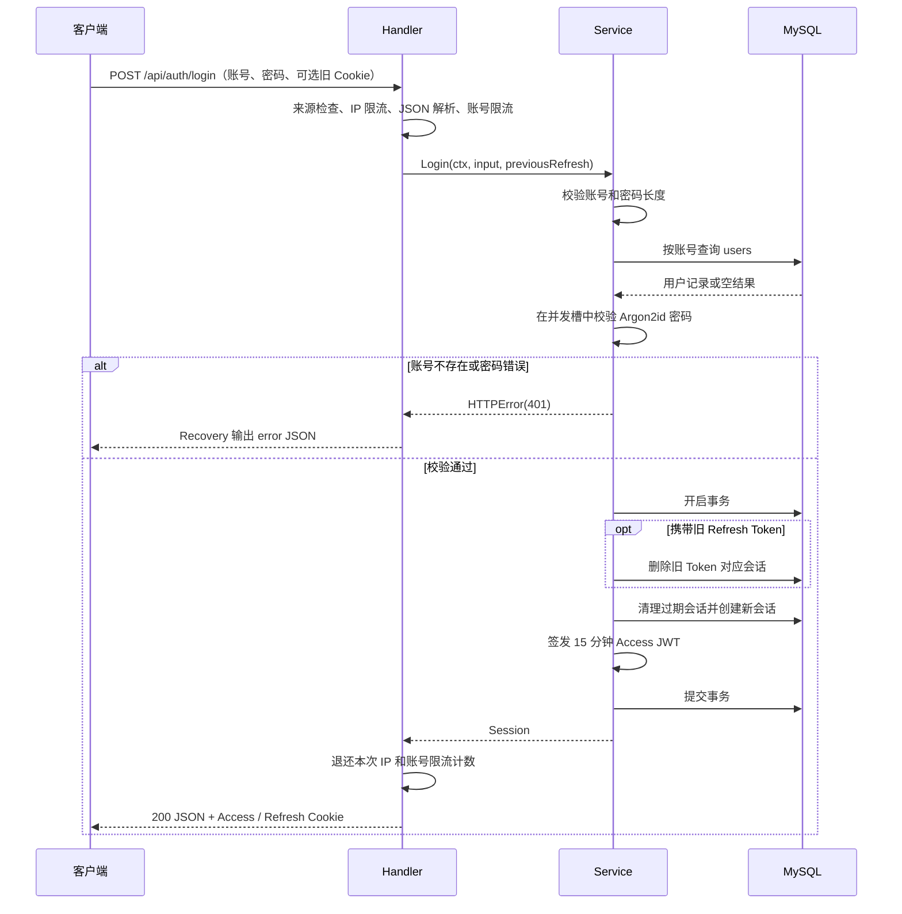

# 登录流程

本文依据当前工作区源码整理，以 `../internal/app/app.go` 为入口，说明服务初始化、账号密码登录、请求鉴权、刷新和退出的完整链路。这里记录的是代码行为，未进行运行环境联调；前端处理建议单独标明。

核心机制：登录成功后创建一条数据库会话，签发有效期为 **15 分钟**的 Access JWT，并通过 HttpOnly Cookie 保存有效期为 **14 天**的 Refresh Token。受保护请求同时校验 JWT 和数据库会话，删除会话后，旧 JWT 即使尚未过期也无法继续鉴权。

## 1. 从 app.go 看登录依赖如何初始化

```text
cmd/voex-server/main.go → app.Run()
  ├─ config.Read()：加载环境配置
  ├─ filestore.New(cfg.Storage)：初始化文件存储
  ├─ database.Open(cfg.Database)：连接数据库并初始化表结构
  ├─ security.LoadSecret(cfg.SecretFile)：读取或创建 JWT 签名密钥
  ├─ service.New(db, files, secret)：构造业务服务
  ├─ router.New(business, cfg.Origins, logger)：注册路由和中间件
  └─ http.Server.ListenAndServe()：开始接收请求
```

`app.Run()` 负责组装依赖，实际登录逻辑在 Handler、Service 和 Repository 中。

| 初始化项 | 与登录的关系 |
| --- | --- |
| `cfg.SecretFile` | 来自 `JWT_SECRET_FILE`，默认 `/home/server/.secrets/jwt-key`；密钥文件不存在时生成 64 字节随机密钥，已有文件至少需要 64 字节 |
| `service.New()` | 保存数据库和签名密钥，创建容量为 4 的密码计算并发槽，并生成用于不存在账号的 `dummyHash` |

| `cfg.Address` | 来自 `VOEX_ADDR`，默认监听 `127.0.0.1:8090` |

密钥文件会在后续启动中复用。更换密钥后，使用旧密钥签发的 Access JWT 将无法通过签名校验；Refresh Token 的校验依赖数据库，现有刷新会话不会仅因更换 JWT 密钥而被删除。

## 2. 路由和调用链

全局中间件按注册顺序为 `AccessLog → Recovery → RequestPolicy`。登录路由属于公开的 `/api` 分组，不要求已有 Access Token，但仍需通过请求来源检查和登录限流。

| 接口 | 是否要求 Access Token | 用途 |
| --- | --- | --- |
| `POST /api/auth/login` | 否 | 校验账号密码并创建会话 |
| `POST /api/auth/refresh` | 否 | 用 `voex_refresh` Cookie 签发新的 Access JWT |
| `POST /api/auth/logout` | 否 | 撤销会话并清理 Cookie |
| `GET /api/auth/me` | 是 | 获取当前用户资料；也注册了 `HEAD` |
| `POST /api/auth/register` | 否 | 创建账号、个人团队和登录会话，成功返回 `201` |

主要调用链：

```text
router.New()
  → Handler.RegisterAuthRoutes(public, protected)
  → Handler.login()
      → Limiter.LimitKey()                  // IP 和账号限流
      → transport.Body()                   // 解析 JSON
      → Service.Login()
          → shared.Characters()            // 校验字段类型和长度
          → repository.AuthUserByAccount() // 查询账号
          → hashSlot() → verifyPassword()  // 校验 Argon2id 密码
          → Service.tx()                   // 开启数据库事务
              → AuthRevokeRefresh()        // 有旧刷新 Cookie 时删除对应会话
              → createSession()
                  → AuthDeleteExpired()
                  → AuthCreateSession()
                  → issueAccess() → signAccess()
      → 退还本次限流计数
      → writeSession()                     // 写 Cookie 和 JSON
```

## 3. 账号密码登录

### 3.1 请求格式

```http
POST /api/auth/login
Content-Type: application/json

{
  "account": "demo_user",
  "password": "example_password"
}
```

以上账号和密码仅用于展示请求格式，需要替换为已注册的凭据。

- 请求体必须是 JSON 对象，大小上限为 2 MiB。
- `account` 必须是字符串，长度为 8–64 个 Unicode 字符。
- `password` 必须是字符串，长度为 10–128 个 Unicode 字符。
- 账号按原始字节查询，不去除首尾空白、不转换大小写；密码同样不执行 trim。
- 浏览器如果已有 `voex_refresh` Cookie，登录 Handler 会将其作为 `previousRefresh` 传入 Service。

### 3.2 登录时序



账号不存在时也使用 `dummyHash` 执行密码校验，再统一返回 `账号或密码不正确`。密码校验使用 Argon2id，哈希结果通过常量时间比较确认是否匹配；服务同时最多执行 4 个密码计算任务，没有空闲槽时立即返回 `429`。

登录成功后，事务内依次执行：

1. 如果携带旧 Refresh Token，按其 SHA-256 摘要删除对应的会话；删除条件未限定为本次登录用户。
2. 清理 `auth_sessions` 中已经过期的记录。
3. 生成 UUID 作为会话 ID，生成 32 字节随机 Refresh Token，编码后为 43 个 Base64URL 字符。
4. 创建会话，数据库仅保存 Refresh Token 的 SHA-256 十六进制摘要，过期时间为数据库 UTC 当前时间加 14 天。
5. 签发 Access JWT，提交事务后返回结果。

仅删除旧 Cookie 指向的会话，不会统一注销该用户在其他设备上的会话。旧会话删除和新会话创建在同一事务中，事务失败会回滚。

### 3.3 登录响应

下面是响应结构示意，Token 和用户 ID 为占位内容：

```json
{
  "accessToken": "<Access JWT>",
  "expiresIn": 900,
  "user": {
    "id": "<用户 UUID>",
    "account": "demo_user",
    "name": "演示用户",
    "avator": "",
    "email": "",
    "phone": ""
  }
}
```

`RefreshToken` 在 `Session` 中标记为 `json:"-"`，不会出现在 JSON 中。头像字段沿用项目当前拼写 `avator`。

| Cookie | Path | 生命周期 | 写入时机 |
| --- | --- | --- | --- |
| `voex_access` | `/api` | 900 秒 | 登录、注册、刷新成功 |
| `voex_refresh` | `/api/auth` | 14 天 | 登录、注册成功；刷新不重新写入 |

两个 Cookie 均设置 `HttpOnly`、`SameSite=Strict`、`Max-Age` 和 `Expires`，未设置 `Domain`。`Secure` 根据请求判断：直接 TLS 请求，或回环代理传入的 `X-Forwarded-Proto: https`，会设置为 `true`。

## 4. 登录后的请求鉴权

受保护路由经过 `middleware.Authentication(s, false)`，执行以下步骤：

1. `transport.AccessToken()` 提取 Token：没有 `Authorization` 头时读取 `voex_access` Cookie；有该头时仅解析 `Bearer <token>`。头格式错误、内容为空或 JWT 无效时，不回退到 Cookie。
2. `Service.Authenticate()` 校验 Access JWT：HS256 签名、非空 `sub` / `sid`、`iss=voex`、`aud` 包含 `voex-web`、有效期；存在 `nbf` 时也检查生效时间。签发内容包括 `sub`、`sid`、`iss`、`aud`、`iat`、`exp`。
3. 使用 `sub`（用户 ID）和 `sid`（会话 ID）关联查询 `users` 与 `auth_sessions`，要求会话仍存在且 `expires_at > UTC_TIMESTAMP()`。
4. 使用 `identity.WithUser()` 将当前数据库用户资料和会话 ID 写入请求 Context，后续 Handler / Service 从 Context 获取身份。

例如 `GET /api/auth/me` 返回 Context 中的用户资料，不返回 Token。资料来自本次鉴权的数据库查询，Access JWT 不保存昵称、头像等资料。

## 5. Access Token 刷新

客户端调用 `POST /api/auth/refresh` 并携带 `voex_refresh` Cookie，无需有效 Access Token，也不要求 JSON 请求体。实现仅从 Cookie 读取 Refresh Token。

```text
读取 voex_refresh
  → 校验格式：43 个 Base64URL 字符
  → 计算 SHA-256 摘要
  → 查询对应会话和用户，要求会话未过期
  → 为同一个 sid 签发新的 15 分钟 Access JWT
  → 更新 voex_access Cookie，返回 accessToken / expiresIn / user
```

刷新不轮换 Refresh Token，不新增数据库会话，不延长数据库的 14 天期限，也不重新写入刷新 Cookie。

- Cookie 缺失或格式不正确：`401`，`请重新登录`；当前代码不会在这个分支清理 Cookie。
- Token 格式正确，但找不到有效会话：`401`，`登录已过期，请重新登录`；Handler 会清理两个会话 Cookie。
- 刷新与账号可用性检查共用 `auth-availability` 限流桶，同一 IP 每分钟最多 60 次，超限提示 `检测过于频繁，请稍后重试`。

## 6. 退出登录

`POST /api/auth/logout` 不要求先通过鉴权中间件，也不要求请求体：

1. 尝试校验 Access JWT，允许忽略过期时间，但仍需通过签名、用户 ID、会话 ID、issuer / audience 等检查；成功后按 `sid + sub` 删除会话。
2. 如果携带 `voex_refresh` Cookie，再按其摘要删除对应会话。
3. 清理 `voex_access` 和 `voex_refresh` Cookie，返回 `{"success":true}`。

无凭据或会话已删除时仍可返回成功；来源检查或数据库错误仍可能导致请求失败。成功删除会话后，后续受保护请求会因查不到会话而拒绝访问。

## 7. 限流和错误处理

登录请求先占用 IP 限流计数，再解析 JSON、占用账号限流计数。账号为字符串时使用原始账号的 SHA-256 摘要作为账号桶标识；否则使用 IP 标识作为该桶的后缀。

| 限制项 | 当前配置 | 计数行为 |
| --- | --- | --- |
| 登录 IP 桶 | 15 分钟内最多 30 次 | 成功登录后退还本次计数 |
| 登录账号桶 | 15 分钟内最多 10 次 | 成功登录后退还本次计数 |
| 密码计算并发 | 同时最多 4 个任务 | 无空闲槽时立即拒绝 |

限流器存储在当前进程内，窗口从该桶首次计数开始。退款仅发生在 `Service.Login()` 成功返回后，失败请求保留已经占用的计数；因此并非只有“密码错误”才会计数，JSON 错误、参数错误、计算繁忙等失败也可能计数。成功登录不会清空之前积累的失败次数。

`shared.Fail()` 通过 `panic(shared.HTTPError)` 中断请求，由 `middleware.Recovery()` 转成 HTTP 状态码和 JSON：

```json
{"error":"账号或密码不正确"}
```

| 场景 | HTTP 状态码 | 提示 |
| --- | --- | --- |
| 非 JSON 对象、字段类型或长度错误 | `400` | 具体格式或长度提示 |
| 账号不存在或密码不匹配 | `401` | `账号或密码不正确` |
| 受保护请求无 Access Token | `401` | `请先登录` |
| Access JWT 无效或过期 | `401` | `登录已过期，请重新登录` |
| JWT 有效，但用户或会话不存在、会话过期 | `401` | `登录已失效，请重新登录` |
| 写请求来源不受信任 | `403` | `请求来源不受信任` |
| 登录 JSON 超过 2 MiB | `413` | `请求内容超过大小限制` |
| 登录 IP / 账号桶超限 | `429` | `尝试次数过多，请稍后重试` |
| 密码计算并发槽已满 | `429` | `登录服务繁忙，请稍后重试` |
| 未单独映射的内部错误 | `500` | `服务器处理失败，请稍后重试` |

POST 等写请求若携带 `Origin`，必须是请求自身来源或配置允许的来源；没有 `Origin` 但 `Sec-Fetch-Site=cross-site` 时也会被拒绝。

## 8. 前端衔接建议

以下是基于服务端接口的接入建议，未核实实际前端实现：

1. 登录成功后保存用户资料。采用 Cookie 鉴权即可由浏览器携带 `voex_access`；如采用 Bearer 方式，则更新内存中的 `accessToken`。
2. 页面重新加载时先请求 `/api/auth/me`；因 Access Token 缺失或过期收到 `401` 时，尝试一次刷新，成功后更新身份并重试原请求。
3. 多个请求同时收到 `401` 时，共享一个正在执行的刷新请求，避免重复刷新触发限流；重试仍失败时结束重试。
4. 刷新返回 `401` 时清理客户端登录状态并进入登录页；`429`、网络失败和服务端异常应分别处理。
5. 退出时调用 `/api/auth/logout`，成功后清理客户端用户资料和内存 Token。

需要 Cookie 的跨 Origin 请求应启用 credentials，并确保来源被允许。当前 Cookie 为 `SameSite=Strict`，跨站请求是否携带 Cookie 仍受浏览器限制，仅配置 CORS 不能保证跨站登录可用。若使用 Bearer Token，刷新成功后也需同步更新它，否则已有 `Authorization` 头会优先于最新 Cookie。

## 9. 源码索引

| 文件 | 重点入口 |
| --- | --- |
| [app.go](../internal/app/app.go) | `Run`：依赖组装和 HTTP 服务启动 |
| [config.go](../internal/config/config.go) | `Read`：监听地址、密钥路径、允许的来源 |
| [router.go](../internal/router/router.go) | `New`：全局中间件、公开和受保护路由分组 |
| [handler/auth.go](../internal/handler/auth.go) | `RegisterAuthRoutes`、`login`、`writeSession`、`refresh`、`logout` |
| [service/auth.go](../internal/service/auth.go) | `Login`、`createSession`、`Authenticate`、`Refresh`、`Logout` |
| [password.go](../internal/service/password.go) | `signAccess`、`verifyAccess`、`verifyPassword`、`hashSlot` |
| [service.go](../internal/service/service.go) | `New`：密码计算槽和 dummy hash；`tx`：事务入口 |
| [repository/auth.go](../internal/repository/auth.go) | 账号查询、会话创建、查询、删除 |
| [middleware.go](../internal/middleware/middleware.go) | `Recovery`、`RequestPolicy`、`Authentication` |
| [transport/session.go](../internal/transport/session.go) | Token 提取、Cookie 写入和清理 |
| [transport/input.go](../internal/transport/input.go) | `BodyRequest`：JSON 格式及大小检查 |
| [security/http.go](../internal/security/http.go) | `LimitKey`、`RateIP`、`SecureRequest` |
| [security/secret.go](../internal/security/secret.go) | `LoadSecret`：JWT 密钥持久化 |
| [identity/context.go](../internal/identity/context.go) | `WithUser`、`User`：请求身份上下文 |
